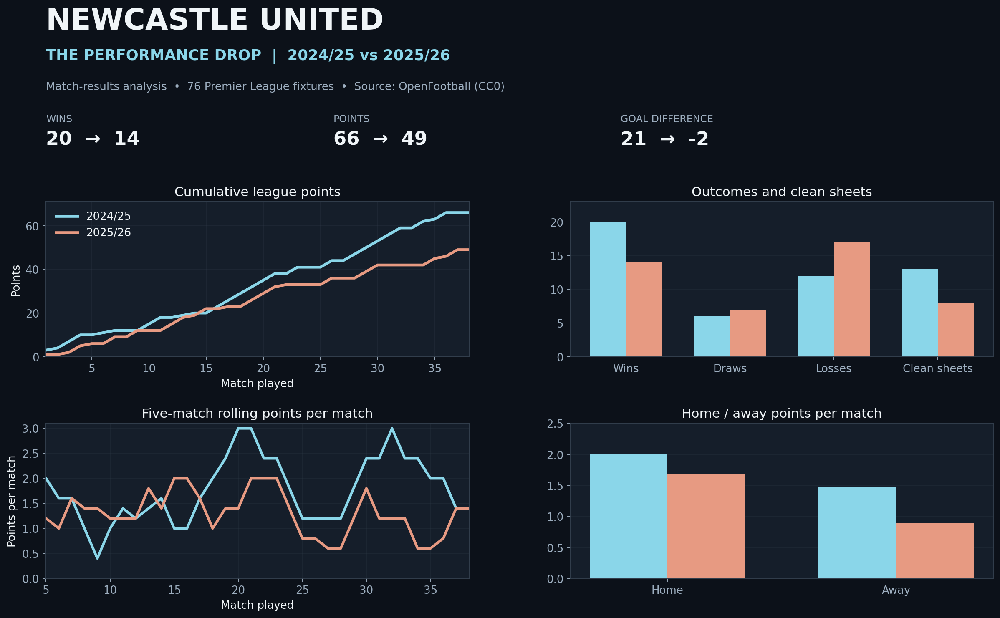
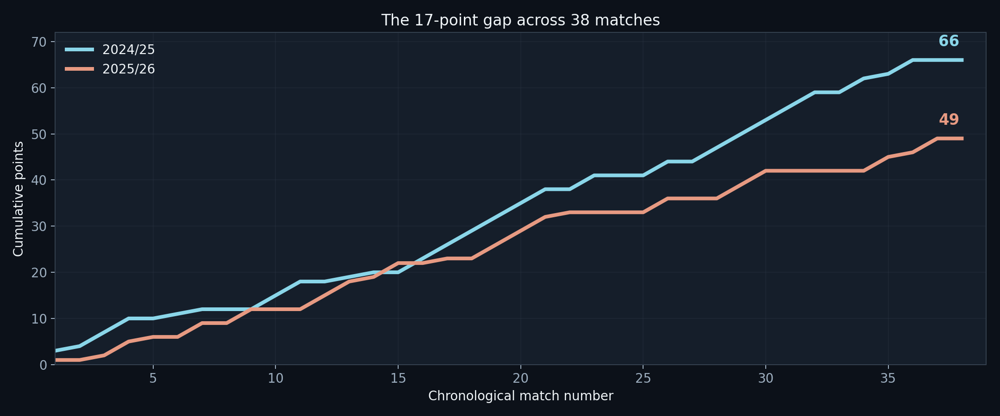
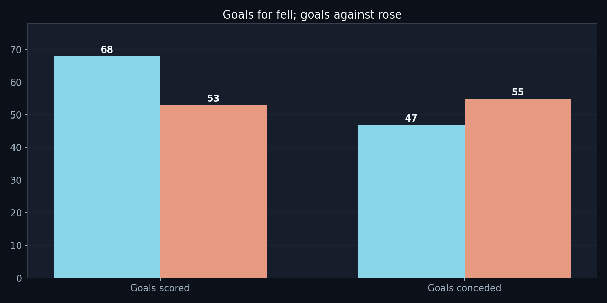

# Newcastle United — The Performance Drop, 2024/25 vs 2025/26

### A real-data Premier League performance investigation · Excel + Python + interactive dashboard



> **The question:** What changed between Newcastle United's 5th-place finish in 2024/25 and their 12th-place finish in 2025/26? This project uses **real, verifiable match-result data**, not generated statistics, to examine the difference.

**[Open the offline interactive dashboard](dashboard/index.html)** · **[Excel analysis workbook](newcastle_performance_analysis.xlsx)** · **[Full case study](docs/CASE_STUDY.md)** · **[Download the original source](https://github.com/openfootball/football.json)**

## Executive summary

| KPI | 2024/25 | 2025/26 | Change |
|:---|---:|---:|---:|
| Final Premier League position | **5th** | **12th** | −7 places |
| League wins | 20 | 14 | **−6** |
| League points | 66 | 49 | **−17** |
| Win rate | 52.6% | 36.8% | **−15.8 percentage points** |
| Goals scored | 68 | 53 | **−15** |
| Goals conceded | 47 | 55 | **+8** |
| Goal difference | +21 | −2 | **−23** |
| Clean sheets | 13 | 8 | −5 |

All figures are calculated from **38 completed Newcastle Premier League fixtures per season** and checked against the published [2024/25](https://www.premierleague.com/en/tables/premier-league/2024-25) and [2025/26](https://www.premierleague.com/en/tables/premier-league/2025-26) final league tables.

## The findings behind the headline

**1. Away output fell sharply.** Newcastle's away points decreased **28 → 17**, and away goals scored decreased **28 → 17**, across 19 away matches in each season. The away-point gap of 11 represents **64.7% of the total 17-point decline**. Away goals *conceded* actually decreased from 27 to 25, so a fall in away scoring is an especially notable observable pattern.

**2. Defensive results at home deteriorated.** Home goals conceded rose **20 → 30**, while home clean sheets fell **8 → 3**. The pattern differs from the away-game story and gives a more useful view than simply saying Newcastle conceded eight more goals overall.

**3. The late-season comparison is worse.** In each club's first 19 chronologically played fixtures, points were **32 → 26**. In the final 19, the corresponding points were **34 → 23**. This is a *descriptive* result, not evidence of a specific underlying cause.

See the [full narrative case study](docs/CASE_STUDY.md) and [methodology](docs/METHODOLOGY.md) for assumptions, calculations and limitations.

## Dashboard preview





The **[HTML dashboard](dashboard/index.html)** is a self-contained offline file (no server, account or API key). It includes four comparative charts, a metric panel and an interactive 76-match table with filters for season, venue, result and opponent. Download it and open it in Safari, Chrome or Firefox. GitHub does not execute local HTML in the repository preview; for a hosted public dashboard, deploy this directory through GitHub Pages or another static host.

The workbook **`newcastle_performance_analysis.xlsx`** contains six sheets: Overview, Season KPIs, Match Log, League Table, Venue Analysis and Sources and Notes. Match-level result/points calculations and summary totals use Excel formulas. It works with Excel on macOS; the provided CSV extracts are also Tableau-ready.

## Files and what they demonstrate

```text
newcastle-performance-analysis/
├── README.md                           # Portfolio landing page
├── dashboard/index.html                # Offline, interactive dashboard
├── newcastle_performance_analysis.xlsx # Formula-driven, readable Excel workbook
├── visuals/                             # GitHub-ready PNG visual summaries
├── data/
│   ├── source_manifest.json            # Source links, license, pinned commit & file hashes
│   └── processed/
│       ├── newcastle_source_extract.csv # 76 original Newcastle fixture observations
│       ├── newcastle_matches.csv        # Cleaned, derived 76-match fact table
│       ├── premier_league_standings.csv # 40 official-result-derived table records
│       ├── season_summary.csv           # 2-year KPI comparison
│       ├── venue_summary.csv            # 19-home / 19-away breakdowns
│       ├── half_season_summary.csv      # First/last 19 games
│       ├── monthly_summary.csv          # Monthly result trends
│       └── opponent_comparison.csv      # 16 shared opponents, paired season comparisons
├── docs/
│   ├── CASE_STUDY.md                    # Analyst's findings and caveats
│   ├── METHODOLOGY.md                   # Source-to-metric logic and limitations
│   ├── DATA_DICTIONARY.md               # Column-level definitions
│   ├── TABLEAU_GUIDE.md                 # Mac-friendly Tableau dashboard walkthrough
│   ├── data_quality.json               # 38/38 consistency, shape and completeness checks
│   └── run_summary.json                # Machine-readable run results
├── notebooks/analysis_walkthrough.ipynb # Guided reproducible notebook
├── src/analysis.py                     # Robust extract/clean/analyse pipeline
├── src/visualize.py                    # Dashboard/PNG renderer
├── scripts/build_workbook.py           # Artifact-tool Excel authoring recipe (optional)
├── tests/test_analysis.py              # Automated calculation and data-quality tests
├── .github/workflows/check.yml         # GitHub Actions CI
├── requirements.txt
└── LICENSE
```

## Put this project on GitHub and publish the dashboard

1. Create a new **public** GitHub repository, suggested name: `newcastle-united-performance-analysis` (do not add another README when creating it).
2. Download and extract the project ZIP, then upload its **contents** (including `.github/`, `dashboard/`, `docs/`, `data/` and `README.md`) into the new repository. GitHub's **Add file → Upload files** is fine for the HTML dashboard.
3. The **Verify Newcastle source analysis** GitHub Action will run on push and check the real data calculations.
4. Optional live dashboard: in repository **Settings → Pages**, select **GitHub Actions** as the source. Then open **Actions → Publish standalone analytics dashboard → Run workflow**. This will deploy the self-contained dashboard so hiring managers can open it in a browser instead of downloading an HTML file.

GitHub repository: [hamadlehdan/newcastle-united-performance-analysis](https://github.com/hamadlehdan/newcastle-united-performance-analysis). The hosted GitHub Pages dashboard must be enabled separately in repository Settings → Pages.

## Try it on a Mac

To **browse the completed portfolio**, no Python, SQL or special software is required: open `dashboard/index.html` in your browser and `newcastle_performance_analysis.xlsx` in Excel.

To **reproduce the analysis** from the checked-in verified fixture extract:

```bash
python3 -m venv .venv
source .venv/bin/activate
pip install -r requirements.txt
python -m src.analysis --offline
python -m pytest -q
```

To download the original **complete** OpenFootball data and rebuild the extracts, use `python -m src.analysis --refresh` (internet required). Refresh uses a **pinned upstream commit** for stable, reproducible results instead of a moving branch. The original raw JSON is intentionally linked rather than duplicated in this portfolio; the real 76-match extracted observations and all computed tables are checked in.

## Data integrity and a useful cleaning lesson

**Source:** [openfootball/football.json](https://github.com/openfootball/football.json), first-division English Premier League JSON files [2024/25](https://github.com/openfootball/football.json/blob/e6744429ee395bc86f247348c6184bb08d4eb361/2024-25/en.1.json) and [2025/26](https://github.com/openfootball/football.json/blob/e6744429ee395bc86f247348c6184bb08d4eb361/2025-26/en.1.json). Snapshot commit: [`e674442`](https://github.com/openfootball/football.json/commit/e6744429ee395bc86f247348c6184bb08d4eb361), checked 20 November 2026. Source data license: **CC0-1.0**.

A noteworthy inconsistency: the 2025/26 file contains **353 full-time score objects and 27 direct score arrays**. A naïve script reading only `score.ft` would fail or silently miss some results. This pipeline handles both formats and rejects invalid scores; it checks all 76 Newcastle matches, 38 distinct matchweeks per season, the points arithmetic and final rankings. Missing half-time values are **not invented**.

### A crucial limitation

This specific source contains match outcomes and goal totals, not **xG, possession, shots, passing or player availability**. None of those unsupported measures appear in the conclusions. The analysis describes the size and location of the change; it does not claim to prove the tactical, managerial or personnel causes. This restraint is intentional analytical quality control.

## Skills demonstrated

- Working with a real, public-source sports dataset; source provenance, version pinning and verification
- Cleaning inconsistent JSON structures, validating categorical results and auditing missing data
- Metric definition and comparative analysis: wins, points, goals, win rates, home/away and opponent-level performance
- Excel modelling and spreadsheet charts; Tableau-compatible dataset preparation
- Building audience-friendly static and interactive data visualisations
- Writing a concise evidence-backed narrative and stating limitations
- Repeatable workflow and automated test coverage using GitHub Actions

## Portfolio note

This project is an independently constructed analytical case study, not an official Newcastle United or Premier League publication. The project code and original prose are under MIT; OpenFootball data is under CC0-1.0. No club imagery or trademarks are licensed or included.